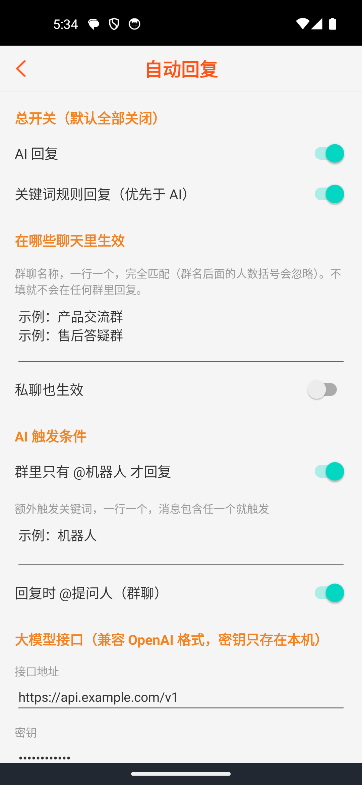
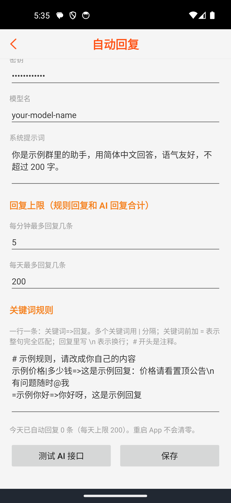

# 企微群管家（安卓）

> 篝火出品 · 基于开源项目 [gallonyin/worktool](https://github.com/gallonyin/worktool)（Apache-2.0，2.8.0 开源版）二次开发，新增「AI 回复」和「关键词规则回复」。

## 风险与免责

**本工具通过安卓无障碍服务自动操作企业微信 / 微信，属于非官方方式，可能导致账号被限制、被禁言或封号，也可能违反平台规则，仅供学习研究。** 请遵守腾讯运营规范与法律法规，不要用于骚扰、营销轰炸或其他违法用途；账号曾被封禁或禁言的，请不要使用。使用后果自负。

- 请先用小号测试，不要用重要账号。
- 自动回复默认**全部关闭**，且只在你指定的群里生效，并有每分钟 / 每天回复上限。上限建议保持低频。
- 开启 AI 回复后，被回复的消息内容会发送到**你自己填写的大模型接口**，请确认该服务可信，并避免在涉及隐私和商业机密的群里使用。
- 这是 2023 年的开源历史版本，**可能无法兼容当前的企微 / 微信新版本**（上游标注的兼容范围见下文）。**未实测**：篝火整理时没有企业微信账号，新增功能的逻辑由单元测试覆盖，界面在模拟器里检查过，但没有在真实企业微信里跑过。

## 下载

到 [Releases](https://github.com/campfire-code/wecom-group-manager-android/releases/latest) 下载 `wecom-group-manager-android_<版本>_android.apk`（安卓 7.0 及以上），附 `SHA256SUMS.txt` 可核对。

## 新增功能怎么用

打开 App 的「设置」页，点「自动回复（AI / 关键词）」。

1. **在哪些聊天里生效**：在「群聊名称」里一行填一个群名（完全匹配，群名后面的人数括号自动忽略）。不填就不会在任何群里回复；私聊要单独打开「私聊也生效」。
2. **关键词规则回复**（优先于 AI）：打开开关，在规则框里一行写一条：
   - `价格|多少钱=>回复内容`：消息包含「价格」或「多少钱」就回复；
   - `=你好=>你好呀`：关键词前加 `=` 表示整句完全相同才回复；
   - 回复里写 `\n` 表示换行；`#` 开头的行是注释；按书写顺序，第一条命中的生效。
3. **AI 回复**：打开开关，填你自己的大模型接口（兼容 OpenAI 格式的 `/chat/completions`）：
   - 接口地址：填到 `/v1` 即可，也可以直接写完整的 `/chat/completions` 地址；
   - 密钥、模型名、系统提示词都由你填；密钥只保存在手机本机，不会写进日志；本地模型不需要密钥时可以留空；
   - 触发条件：群里默认只有 **@机器人** 才回复；也可以再填「额外触发关键词」，包含任一个就触发；私聊每条都回复（需打开「私聊也生效」）；
   - 点「测试 AI 接口」会真实请求一次，确认地址、密钥、模型名是否可用。
4. **回复上限**：每分钟、每天最多回复几条（规则回复和 AI 回复合计）；超过后本条不回复。每天的计数保存在本机，重启 App 不会清零。
5. 点「保存」。需要机器人账号已登录企业微信并开启本 App 的无障碍服务（见下文「使用前必读」）。

行为说明：只处理聊天页里**最后一条、别人发的文字消息**；同一条消息只处理一次；每次回复是单轮问答，不带历史上下文。

截图（均为虚构的示例数据）：

## 使用前必读

- **需要自己准备一台安卓手机**，登录企微 / 微信小号，并在系统设置里开启本 App 的无障碍服务。
- 上游 App 默认连接上游厂商的云服务（见源码 `Constant.kt` 里的默认 host），聊天内容与任务会经过该云服务；设置里可以改服务器地址，需要自己有兼容的服务端。上游的后台 / 调度平台不在本仓库里，能否自建**未核实**。**本分支新增的自动回复不依赖后台**，但 App 的启动流程要求先在设置里保存「链接号」，没有后台时随便填一个即可（未实测）。
- 本地自动回复与后台的消息回调可以同时存在；如果后台也会回复，同一条消息可能被回复两次。只用本地自动回复时，可在「回复策略」里选「只读消息不回调」。
- App 内置友盟（Umeng）统计 SDK，会向友盟上报设备与使用统计。
- 接口说明见上游文档：https://worktool.apifox.cn/doc-850007

## 验收用例（需要安卓手机和企业微信小号，未实测）

| 操作 | 应得到 |
|---|---|
| 设置 → 自动回复，打开规则回复，群聊名称填测试群，规则填 `测试=>收到`，保存；在测试群里由另一个号发「测试一下」 | 机器人在群里回复「收到」 |
| 关闭规则，打开 AI 回复并填好接口，点「测试 AI 接口」 | 提示「接口正常」并显示模型回复 |
| 在测试群里发「@机器人名 你好」 | 机器人用 AI 回复；不 @ 时不回复 |
| 把每分钟上限设为 1，连续 @ 两次 | 第二次不回复 |

单元测试（本机可跑）：`./gradlew testDebugUnitTest`，共 31 个，覆盖规则解析与匹配、群名匹配、回复上限计数、大模型请求构造与响应解析（用假传输，不访问网络）、触发条件与去重。

## 和上游的区别

- 新增：自动回复（AI 回复、关键词规则回复），代码在 `app/src/main/java/org/yameida/worktool/autoreply/` 与 `activity/AutoReplyActivity.kt`；只在 `WeworkLoopImpl`（读到消息列表后调用一次）、`WeworkOperationImpl`（新增一个发送入口）、设置页（新增入口）里各有极小改动。
- 不再在启动时自动向上游检查更新（否则会提示安装上游的包，覆盖本分支功能）。
- 构建升级：Gradle 6.1.1 → 7.6.4、Android Gradle 插件 4.0.0 → 7.4.2、Kotlin 1.3.72 → 1.7.22（原版本无法在 JDK 17 上运行）；已停服的 jcenter 与 fabric 仓库换成 mavenCentral 加阿里云 jcenter 镜像；`baselibrary` 的包名 `base` 改为合法的 `org.yameida.baselibrary`；release 关闭 lintVital（上游 targetSdk 30 已过期会拦住构建，本分支不改 targetSdk）；签名只读环境变量。
- 版本号 `2.8.0-campfire.2`，包名不变（`org.yameida.worktool`）。

## 归属与许可证

本仓库由**篝火**整理，上游版权归 [gallonyin/worktool](https://github.com/gallonyin/worktool) 原作者所有，按 Apache-2.0 许可证再分发（LICENSE 见本仓库），新增代码同样按 Apache-2.0 发布。第三方依赖见 `THIRD_PARTY_LICENSES.md`。全部工具目录见 [toolkit-hub](https://github.com/campfire-code/toolkit-hub)。

---

以下为上游原始说明：

## 项目状态说明

⚠️ 当前 GitHub 仓库提供的是开源历史版本，仅用于学习和二次开发参考。

✅ WorkTool 商业版仍在持续维护和更新，持续适配企业微信、微信新版本，并提供技术支持服务。

## WorkTool

WorkTool是一个依附于企微/微信来运行的无人值守群管理机器人程序，您可以使用本应用程序来自动执行一个自己微信里的账号（当做机器人账号），并可通过后台调用对应的 API 来驱动机器人自动执行任务，如收发消息、建群、拉人踢人等。

本工具所有技术实现均基于Android官方系统SDK和企微/微信官方SDK，原理上保证本工具的合法合规性，请勿用于非法用途，一经发现立即封停！

### 本程序分为安卓端APP和任务调度平台

* 安卓端APP需要您**自己提供一台手机**（需可运行企微/微信，手机型号和系统版本不限，本软件兼容99%的安卓手机）。
    如果您是开发者可以自行编译源码运行，进行测试和学习；如果没有研发能力，可使用打包版本[WorkTool APP安装包：点击下载（2026-08-26更新）](https://cdn.asrtts.cn/uploads/worktool/apk/worktool-latest.apk)（兼容4.1.8-4.1.39, 5.0.0-5.0.10）

风险提示：

* 本APP采用Google安卓系统的**官方无障碍服务**，并在此基础上**自研自动化框架，无hook函数、无侵入、无破坏、无内存修改，与PC端RPA完全不同**，手机无需破解Root权限，兼容绝大部分机型，支持长时间运行稳定。工信部发文要求各大APP必须进行无障碍改造，这是**政府和官方支持的唯一自动化方案**，请拒绝黑产，拒绝影响微信生态的任何行为，鼓励无障碍服务改造！[点进跳转工信部文章链接](https://www.gov.cn/zhengce/zhengceku/2020-12/26/content_5573472.htm)
* 如果您的使用场景对信息极为敏感，数据独立隔离或有其他定制需求，可以提交[定制申请](https://admin.worktool.ymdyes.cn/form/consult)获取更高级数据安全方案。
* 如果您的账号曾有被封或禁言等行为，请勿使用本工具！如您的行为违反**腾讯运营规范**或**国家法律规定**，请勿使用本工具！
[点进跳转企业微信安全指南链接](https://open.work.weixin.qq.com/help2/pc/cat?person_id=1&is_tencent=&doc_id=14664)

## 文档

这里有所有详细的API文档和调用示例！！！

这里有所有详细的API文档和调用示例！！！

这里有所有详细的API文档和调用示例！！！

📝 https://worktool.apifox.cn/doc-850007

#  Copyright

Apache License, Version 2.0

#  联系方式
- ⭐️ 合作申请: https://www.ymdyes.cn/contact
- 💻 Email: feedback@yameida.cc
- 🤗 QQ群: 技术交流、问题反馈 1016798508

# 开源版历史版本记录

⚠️ 以下仅为 GitHub 开源版历史更新记录。

商业版仍在持续维护和更新，
最新版本及更新说明请查看详细文档 https://worktool.apifox.cn/doc-850007

v2.8.1 2023-11-19 自动通过好友请求开关;执行队列去重算法优化

v2.8.0 2023-10-18 兼容企微4.1.10;其他已知问题优化

v2.7.4 2023-10-15 消息发送优化和准确率提升

<b>往期更新</b>

v2.7.3 2023-10-12 发送消息优化

v2.7.2 2023-10-10 已知问题修复

v2.7.1 2023-09-11 优化兼容鸿蒙;优化获取群名;其他已知问题修复

v2.7.0 2023-08-27 兼容企微4.1.9;其他已知问题优化

v2.6.8 2023-08-12 删除联系人;其他已知问题优化

v2.6.7 2023-07-31 修复房间类型错误;其他已知问题优化

v2.6.6 2023-07-25 优化消息接收;其他已知问题优化

v2.6.5 2023-07-14 优化发送文件;其他已知问题优化

v2.6.4 2023-06-28 修复发消息功能缺陷;其他已知问题优化

v2.6.3 2023-06-26 日志文件分享

v2.6.2 2023-06-25 增加防卡顿模式;自动删除已退出群;群信息保存通讯录;消息检查优化;其他已知问题修复

v2.6.1 2023-06-13 控件检索优化;其他已知问题修复

v2.6.0 2023-05-28 anr自动处理;其他已知问题修复

v2.5.9 2023-05-12 自动通过群邀请;拉人进群发送邀请;获取群聊全称;获取群二维码;其他已知问题修复

v2.5.8 2023-04-06 优化消息一致性检查;执行异常自动重试;兼容性更新;其他已知问题修复

v2.5.7 2023-03-15 自动通过群邀请;优化消息识别;异常环境监测;其他已知问题修复

v2.5.6 2023-02-06 兼容主流模拟器;其他已知缺陷修复

v2.5.5 2023-02-02 文件发送优化;新消息增强校验;其他已知缺陷修复

v2.5.4 2023-01-28 文件发送优化;消息列表识别优化;切换企业;其他已知缺陷修复

v2.5.3 2023-01-11 群模板兼容新版;消息类型识别优化;其他已知缺陷修复

v2.5.2 2023-01-05 返回首页缺陷修复

v2.5.1 2023-01-04 优化返回首页和回复速度;支持群二维码回调;其他已知缺陷修复

v2.4.2 2022-12-14 优化at;优化通过好友请求;其他已知缺陷修复

v2.4.1 2022-12-9 集成悬浮窗启停功能;房间检索优化;界面更新;其他已知缺陷修复

v2.4.0 2022-11-23 修改用户备注;添加待办;重要宕机缺陷修复

v2.3.3 2022-10-28 解散群;改群模板;其他已知问题优化

v2.3.1 2022-10-25 优化推送文件;特殊符号兼容;交互提示;其他已知问题修复

v2.3.0 2022-10-17 支持at多人;支持推送任意文件;支持群备注修改;交互提示优化;其他已知问题修复

v2.2.6 2022-09-16 优化搜索

v2.2.5 2022-09-15 主动加好友可改附言;移除[自动回复]前缀;群内回复@提醒;搜索更加精准;学校类企业兼容

v2.2.3 2022-08-26 兼容主动添加好友;文本匹配优化;其他已知问题优化

v2.2.1 2022-08-25 多控件类型兼容;兼容多版本系统;其他已知问题修复

v2.1.2 2022-08-18 多控件类型兼容;兼容多版本系统

v2.1 2022-08-17 真@提醒;获取未读消息优化;其他已知问题修复

v2.0 2022-08-11 全面兼容企业微信最新版本(4.0.12)和政务微信;控件搜索优化;已知问题修复

v1.3 2022-08-02 被动添加好友优化

v1.2 2022-07-11 内部群已读数过滤;避免群名重复创建;可回调获取群二维码;其他稳定性优化

v1.1 2022-06-20 大幅度提高系统稳定性和响应速度

v1.0 2022-05-27 首次可用版本更新

